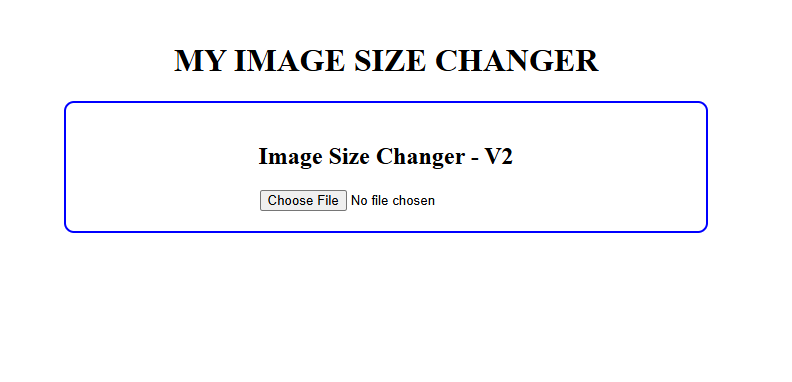
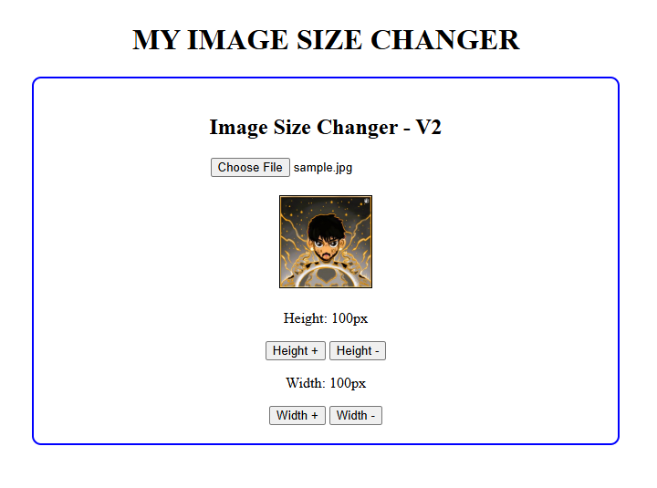

# Image Size Changer — V2

I made this version while continuing to learn React. In V1, I used an image already stored in my project folder. In V2, I wanted to make the application more interactive by allowing users to upload their own images.

The uploaded image starts at 100 × 100 pixels, and users can increase or decrease its height and width using buttons.

## 📸 Screenshot


<hr>   



## ✨ Features

- Upload an image from your computer
- Set the uploaded image's initial size to 100 × 100 pixels
- Increase or decrease height by 10px
- Increase or decrease width by 10px
- Display the image only after it has been selected
- Prevent the dimensions from going below 10px

## 💭 My Approach

My idea was to improve V1 so users would not have to depend on an image stored inside the project. I wanted them to select an image at runtime and resize it using the same buttons.

To implement this, I added a file input and used the `onChange` event to handle image selection. I used React state to store the selected image URL, height, and width. Whenever a new image is uploaded, its dimensions are reset to 100 × 100 pixels.

## ⚙️ How It Works

1. The user selects an image using the file input.
2. The `handleImageUpload()` function gets the selected file using `event.target.files[0]`.
3. `URL.createObjectURL()` creates a temporary URL that the browser can use to display the image.
4. The image URL is stored in state using `setImageUrl()`, while the height and width are reset to 100px.
5. The image and resize buttons appear only after an image has been selected.
6. When a resize button is clicked, the corresponding function updates the height or width state by 10px.
7. React re-renders the component and displays the image with its updated dimensions.
8. I also used `useEffect` to release the temporary image URL when it is no longer needed.

## 🛠️ Technologies Used

- React
- JavaScript
- HTML
- CSS
- Vite

## 📚 What I Learned

- Handling file input using `onChange`
- Accessing a selected file with `event.target.files[0]`
- Displaying uploaded images using `URL.createObjectURL()`
- Using `useState` to store an image URL and its dimensions
- Conditionally rendering elements based on state
- Using `useEffect` for cleanup
- Reusing the resizing logic from V1 with user-uploaded images

## ▶️ How to Run

Open the V2 project folder in your terminal and run:

```bash
npm install
npm run dev
```

Open the local URL provided by Vite in your browser.

## 💡 Next Step

In V3, I plan to display the uploaded image at its original dimensions instead of forcing it to 100 × 100 pixels. I also want to add buttons that increase or decrease both dimensions proportionally while maintaining the image's original aspect ratio.

I'm building each version step by step to understand React concepts through practical implementation.