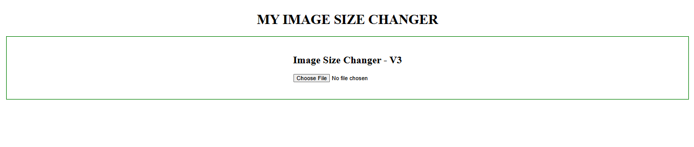
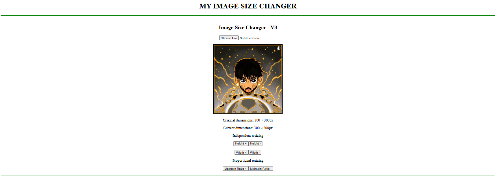

# Image Size Changer — V3

I made this version while continuing to learn React. In V1, I used a fixed image, and in V2, I added the option to upload an image from the computer.

In V3, I wanted to make the application better by displaying an uploaded image at its original dimensions and adding an option to resize it proportionally without stretching it.

## 📸 Screenshot




## ✨ Features

- Upload an image from your computer
- Display the image at its original dimensions
- Increase or decrease height independently by 10px
- Increase or decrease width independently by 10px
- Increase or decrease both dimensions using the Maintain Ratio buttons
- Display the original and current image dimensions

## 💭 My Approach

My idea was to improve V2 because setting every uploaded image to 100 × 100 pixels can stretch it and change its appearance. I wanted the image to start at its actual width and height.

I also wanted to add two buttons that resize the image while maintaining its original aspect ratio. For this, I decided to store the original dimensions separately and use a scale factor to calculate the new dimensions.

## ⚙️ How It Works

1. The user selects an image using the file input.
2. `URL.createObjectURL()` creates a temporary URL to display the uploaded image.
3. The `onLoad` event reads the image's original dimensions using `naturalWidth` and `naturalHeight`.
4. I store the original dimensions, current height, and current width using `useState`.
5. The Height and Width buttons change their respective dimensions independently in steps of 10px.
6. The Maintain Ratio buttons update a scale factor and calculate both dimensions using the original width and height.
7. React updates the image and dimension values whenever the corresponding state changes.
8. I used `useEffect` to clean up the temporary image URL when it is no longer needed.

## 🛠️ Technologies Used

- React
- JavaScript
- HTML
- CSS
- Vite

## 📚 What I Learned

- Using multiple `useState` variables to manage image information
- Handling image uploads and the `onLoad` event
- Reading an image's natural dimensions
- Using a scale factor to calculate proportional dimensions
- Updating multiple state variables through event handlers
- Using conditional rendering to display controls after an image loads
- Using `useEffect` for cleanup

## ▶️ How to Run

Open the V3 project folder in your terminal and run:

```bash
npm install
npm run dev
```

Open the local URL provided by Vite in your browser.

## 💡 Final Thoughts

Building this project in three versions helped me understand React step by step. I started with basic state updates, then learned how to handle image uploads, and finally worked with original image dimensions and proportional resizing.

This was a practical way for me to learn new concepts by adding one feature at a time instead of building everything in a single version.